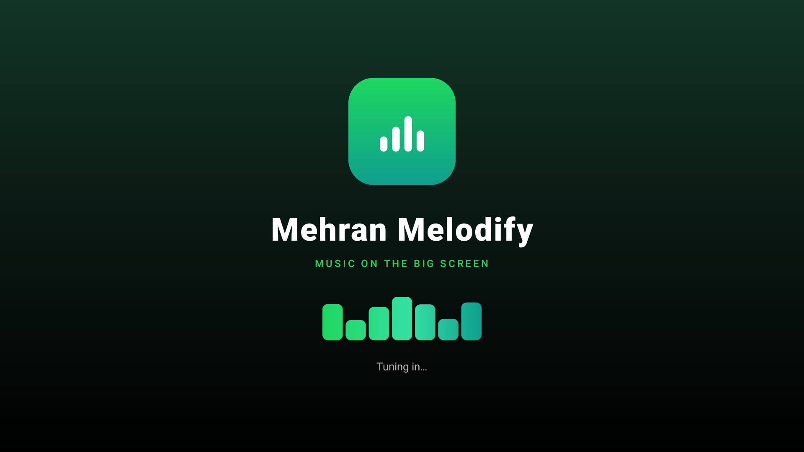
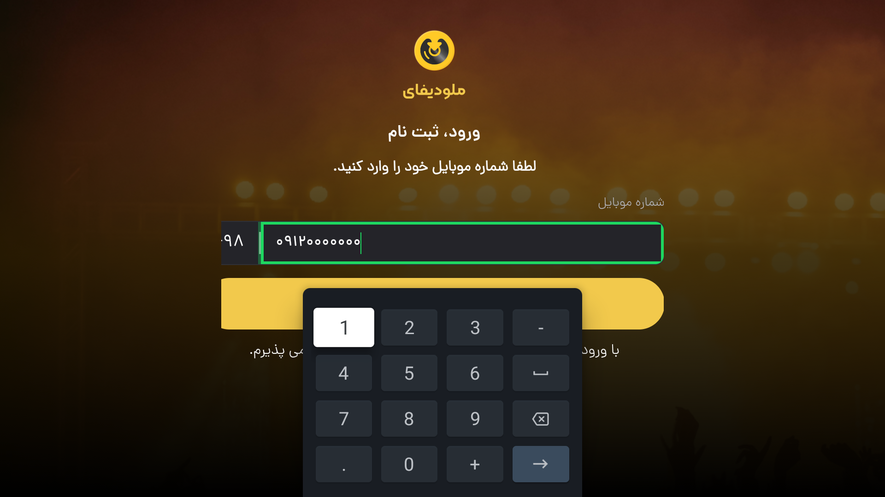

# Mehran Melodify

A native Android TV / NetBox wrapper for **https://desktop.melodify.app/login/get-number**.

The app is a full-screen WebView shell with the TV-specific workarounds needed for
D-pad navigation, soft-keyboard entry, session persistence, audio autoplay and
Leanback launcher integration, wrapped in a music-themed intro screen.





---

## Download

Grab the signed APK from the **[latest release](https://github.com/Mehran/Mehran-Melodify/releases/latest)**:

| Release asset | Size |
| --- | --- |
| [`MehranMelodify-1.1.0-armeabi-v7a.apk`](https://github.com/Mehran/Mehran-Melodify/releases/download/v1.1.0/MehranMelodify-1.1.0-armeabi-v7a.apk) | 2.5 MB |
| [`MehranMelodify-1.1.0-armeabi-v7a.apk.sha256`](https://github.com/Mehran/Mehran-Melodify/releases/download/v1.1.0/MehranMelodify-1.1.0-armeabi-v7a.apk.sha256) | checksum |

```bash
adb connect <box-ip>:5555
adb install -r MehranMelodify-1.1.0-armeabi-v7a.apk
```

The same files are committed under `dist/` if you prefer to clone the repo.

---

## Deliverables

| File | Purpose |
| --- | --- |
| `dist/MehranMelodify-1.1.0-armeabi-v7a.apk` | Signed release APK (current) |
| `dist/MehranMelodify-1.1.0-armeabi-v7a.apk.sha256` | SHA-256 checksum |
| `dist/MelodifyTV-1.0.0-armeabi-v7a.apk` | Previous build, kept for rollback |
| `dist/MelodifyTV-AndroidTV-source.zip` | Complete Android Studio project (signing material excluded) |
| `README.md` | This document |

APK SHA-256:

```
e3edc9333b4f4bdb70a23de3de19f86213f238aebde838e14b38d5e327cffe89
```

Package: `app.melodify.tv` · Version: `1.1.0` (versionCode 2)
Min SDK: 21 · Target/compile SDK: 35 · Landscape · Signed with APK signature schemes v1 + v2.

---

## Install on a NetBox / Android TV device

1. Copy `MehranMelodify-1.1.0-armeabi-v7a.apk` to the device or use ADB:
   ```bash
   adb connect <box-ip>:5555
   adb install -r MehranMelodify-1.1.0-armeabi-v7a.apk
   ```
2. Launch **Mehran Melodify** from the Android TV launcher's Apps row. The intro
   plays, then the Melodify login screen appears.

The APK is ABI-neutral: a WebView app contains no native `.so` libraries, so the
`armeabi-v7a` filter does not exclude arm64 or x86 test devices either. It installs
and runs on classic 32-bit NetBox boxes as well as 64-bit Android TV devices.
The device's **Android System WebView** must be reasonably current (the live site is
a modern React app; WebView 90+ is recommended). If the box ships an old WebView,
update **Android System WebView** from the Play Store or install a current WebView APK.

---

## Requirement mapping

### 1. Authentication and cookie persistence
- `CookieManager.setAcceptCookie(true)` and
  `setAcceptThirdPartyCookies(webView, true)` (the API host is a different origin).
- `DOM storage` and `Database` enabled, which also enables IndexedDB used by the
  site's persisted Redux store.
- `CookieManager.flush()` on:
  - every `onPageFinished`,
  - `onPause` and `onStop`,
  - a 5-second periodic timer while the activity is resumed,
  - `onDestroy`.
- The WebView is deliberately **not** paused in `onPause()` so audio and page timers
  keep running when the TV shows another app.

### 2. Android TV remote / D-pad
- `WebView` is `focusable` and `focusableInTouchMode`.
- [`app/src/main/assets/tv-enhance.js`](app/src/main/assets/tv-enhance.js) adds
  spatial directional navigation because Chromium's WebView has no built-in
  TV-style focus movement. It:
  - scans links, buttons, inputs, `role="button"`, `tabindex` and Tailwind
    `cursor-pointer` cards,
  - picks the nearest element in the pressed direction (with a diagonal penalty),
  - focuses it, scrolls it into view, and skips disabled/hidden/inert nodes,
  - enters the UI at the element nearest screen centre on the first key press,
  - keeps the highlight visible with a green outline and inline styles that also
    work if the site's CSP blocks injected `<style>` data.
- On login pages viewed at a short TV viewport (e.g. 960×540 CSS px on 1080p at
  density 2), the injected CSS compacts the site's 124px/100px desktop spacers so
  the phone field and button fit on screen. It is scoped to login routes and is a
  no-op if Melodify changes those class names.

### 3. Soft keyboard and input fields
- A `focusin`/`click` listener on text fields calls the Java bridge, which requests
  the IME with `SHOW_FORCED`. TV remotes register as hardware keyboards, which
  normally suppresses the soft IME.
- **No `WebView.requestFocus()` is issued while the keyboard is open.** On some TV
  WebView builds that call clears the DOM editor's focus and leaves the keyboard
  typing into nothing. This was observed and fixed during testing.
- A 500ms retry covers boxes that ignore the first request while the remote key-up is
  still being processed.
- Input hints are set from the field semantics:
  - phone → `inputmode="tel"`, `autocomplete="tel"`, `enterkeyhint="go"`,
  - OTP/code → `inputmode="numeric"`, `autocomplete="one-time-code"`,
    `enterkeyhint="done"`.
- The field is re-centred after the IME appears, because many TV boxes overlay the
  keyboard instead of resizing the WebView.
- `Enter` is left to the site's own Formik/OTP handlers to avoid a double submit.

### 4. Audio playback and Leanback
- `setMediaPlaybackRequiresUserGesture(false)` so music is not blocked by autoplay
  policy.
- No `WebView.onPause()` call, plus `FLAG_KEEP_SCREEN_ON`, so playback survives the
  app losing window focus.
- Manifest declares both `LAUNCHER` and `LEANBACK_LAUNCHER`, marks touchscreen
  support as not required, and supplies a 320×180 TV banner.
- `KEYCODE_BACK`: WebView history first, then a two-press exit with a toast.
  `KEYCODE_ESCAPE` is treated as Back too. Back on the error screen exits cleanly.
- Full-screen black theme, custom error screen with a D-pad-focusable **Retry**
  button, and a branded loading overlay.

### 5. Music-themed intro and branding
- `SplashActivity` is the `LAUNCHER` / `LEANBACK_LAUNCHER` entry point. It shows the
  logo mark, the **Mehran Melodify** wordmark, the tagline *Music on the big screen*
  and a 7-bar equalizer animated by `EqualizerView`, then fades into the WebView
  after 2.4 s.
- Any remote key skips the intro immediately; **BACK** leaves the app.
- The intro plays once per app process. Returning from **HOME** goes straight to the
  player (so music is never covered by a splash), while a cold start, reboot or
  "force stop" shows it again. Exiting the app with BACK during the intro also
  resets this, so the next launch still plays it.
- One mark drives every asset: a green→teal gradient tile with four white equalizer
  bars, used for the adaptive icon, the legacy launcher PNGs at every density, the
  round icon, the TV banner and the intro logo.

---

## Project structure

```
app/src/main/
├── AndroidManifest.xml
├── assets/tv-enhance.js          # D-pad spatial nav, focus ring, IME hints
├── java/app/melodify/tv/
│   ├── SplashActivity.java       # music-themed intro, then launches the WebView
│   ├── EqualizerView.java        # animated equalizer bars for the intro
│   ├── MainActivity.java         # WebView setup, cookies, IME, back, errors
│   └── WebAppBridge.java         # tiny JS bridge (keyboard + ready signal)
└── res/
    ├── layout/activity_main.xml
    ├── layout/activity_splash.xml
    ├── drawable/logo_mark.png    # intro logo (also drawable-* densities)
    ├── drawable/tv_banner.png    # TV launcher banner
    ├── mipmap-*/                 # launcher icons
    └── values/                   # theme, colors, strings
```

---

## Build from source

Requirements: **JDK 17**, Android SDK **35**, Build-Tools **35.0.0**.

```bash
export JAVA_HOME=/path/to/jdk-17
# Android Studio creates local.properties automatically. For CLI:
echo "sdk.dir=/path/to/Android/Sdk" > local.properties

./gradlew assembleRelease
```

Output: `app/build/outputs/apk/release/app-release.apk`.

Useful checks:

```bash
./gradlew lintRelease
/opt/android-sdk/build-tools/35.0.0/apksigner verify --print-certs app/build/outputs/apk/release/app-release.apk
```

### Signing

The release build reads `keystore.properties` from the project root
(`keystore.properties` and `*.jks` are git-ignored, so **the signing material is
not part of this repository**):

```properties
storeFile=keystore/melodify-release.jks
storePassword=<your-store-password>
keyAlias=<your-key-alias>
keyPassword=<your-key-password>
```

Generate your own key before distributing builds:

```bash
keytool -genkeypair -v -keystore keystore/melodify-release.jks \
  -alias melodify -keyalg RSA -keysize 2048 -validity 10000
```

> The APK attached to this repository is signed with a throwaway key used for
> testing. If you sign a new build with a different key, uninstall the existing app
> first — Android will not update an app with a mismatched signature.

### Changing the start page

Edit `START_URL` in
[`MainActivity.java`](app/src/main/java/app/melodify/tv/MainActivity.java).

### Changing version / package

Edit `applicationId`, `versionCode` and `versionName` in
[`app/build.gradle`](app/build.gradle).

---

## Verification performed

Tested on an **Android 12 TV emulator (1080p, 320 dpi, WebView 91.0.4472.114)**:

- APK installs, launches, and appears as a **leanback-launchable** app with a banner
  in the TV launcher.
- `aapt dump badging` shows `LAUNCHER` + `LEANBACK_LAUNCHER`, touchscreen not
  required, and the correct SDK levels, plus `application-label:'Mehran Melodify'`
  and `launchable-activity: app.melodify.tv.SplashActivity`.
- Branding: the TV launcher's Apps row lists **Mehran Melodify** with the green
  equalizer icon (verified via launcher `content-desc` and a screenshot of the app
  drawer); the banner OCRs as "Mehran / Melodify" at 320×180 and 640×360.
- Intro: on a cold start the splash shows the wordmark and animates the equalizer
  (OCR reads the title/tagline, 7 green bars measured on-screen), then hands over to
  the WebView. Pressing OK during the intro jumps in immediately. Returning from HOME
  skips the intro and resumes the same `MainActivity`/WebView instance.
- D-pad: Down from the idle login screen focuses the phone field; Up/Down moves
  between the field and the Confirm button; a 3×3 grid test moved Right → Down →
  Left exactly as expected with a visible green focus ring.
- Soft keyboard: initiated via `SHOW_FORCED`; numeric keypad is displayed, and
  digits typed into the focused field update its value. No focus/IME loop after the
  `requestFocus()` fix.
- Enter/IME action: submitting the empty phone form surfaced the site's
  "شماره تلفن را وارد کنید" validation message, confirming submit wiring.
- Session: a persistent cookie (`max-age=86400`) and a localStorage key both survived
  HOME + force-stop + relaunch. Logout clears the site's storage as designed.
- Error path: loading an unreachable host displayed **Can't reach Melodify** with a
  focused **Retry** button; Back exits the error screen.
- Back: first Back shows "Press BACK again to exit", second Back returns to the TV
  launcher.
- `./gradlew lintRelease` passes.
- `apksigner` verifies v1 + v2 signatures; SHA-256 recorded above.
- v1.1.0 keeps the `app.melodify.tv` package id and signing key of v1.0.0, so it
  installs with `adb install -r` over the previous build instead of requiring an
  uninstall (verified on the emulator).

### Not verified / caveats

- A real phone number was **not** submitted, to avoid sending an OTP SMS to an
  unknown person. The login button, validation path and Enter handling were verified
  without hitting the SMS endpoint.
- Melodify is a third-party service; this project is an independent wrapper and is not
  affiliated with it. Changes to the site can affect layout/compaction or break the
  web app itself.
- Background audio is kept alive by not pausing the WebView, but aggressive TV
  firmware may still kill background processes. There is no separate native media
  service.
- The site UI is Persian/RTL; the wrapper does not translate it.
